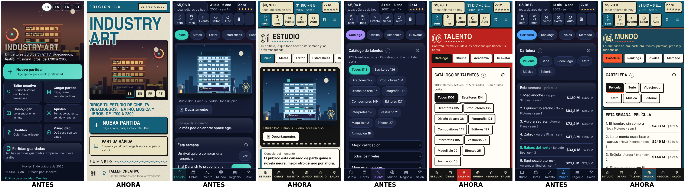
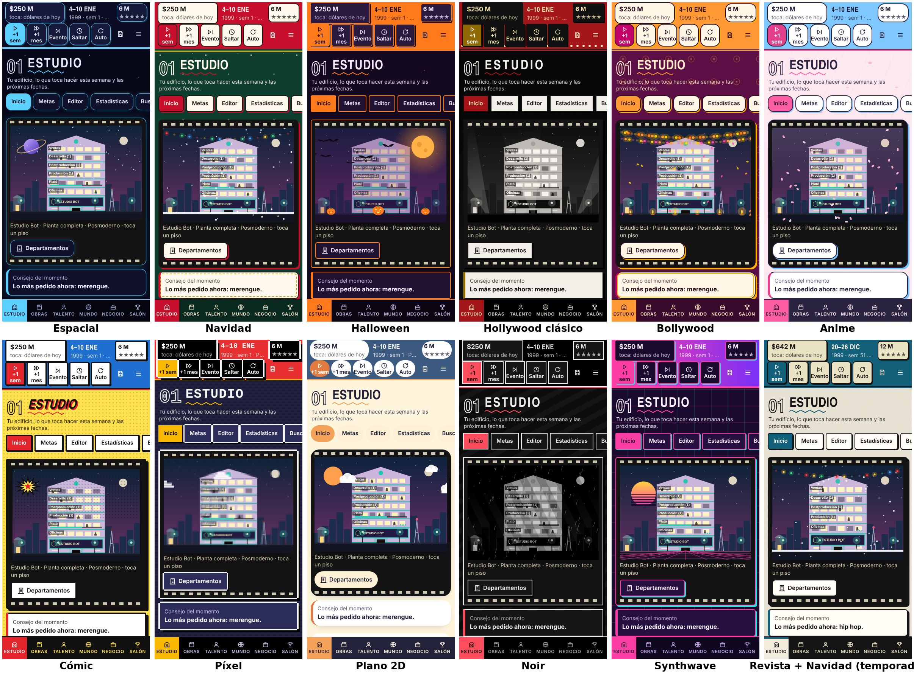

# UnoCero

## INDUSTRY ART · versión 1.0

Simulador de estudio de cine, series, videojuegos, teatro, música y libros, de 1700 a 2300.

### Jugar

Abre `industry-art/index.html` en cualquier navegador moderno, en el celular o en el computador. No necesita instalación ni conexión: todo el juego está en ese archivo.

- **Partida rápida**: un toque y el dado elige la época, el país y tu estudio.
- **Nueva partida**: eliges época, lugar, compañía, avatar, dinero y dificultad.
- Idiomas: español, inglés, francés y portugués.
- Las partidas se guardan en el navegador (5 ranuras y autoguardado) y se pueden exportar como `.iasave`.

### Diseño

- **Revista** (predeterminado): cada sección del juego es una sección de revista con su propio color de papel.
- **Época**: el diseño cambia con los años, igual que tu edificio: gaceta, art déco, pop, Memphis, digital y ciencia ficción.
- También: Minimalista, Oscuro, Claro, Alto contraste, Medianoche, Cine clásico, Bosque y Papel.
- **Temas especiales**: Espacial, Navidad, Halloween, Hollywood clásico, Bollywood, Anime, Cómic, Píxel, Plano 2D, Noir y Synthwave. Cambian los colores y decoran las ilustraciones; Píxel dibuja las ilustraciones en píxeles y Hollywood clásico y Noir las pasan a blanco y negro.
- **Decoración de temporada**: en cualquier tema, el edificio celebra Halloween, Navidad y Año Nuevo según el calendario del juego.

### Android

El proyecto de la app está en `android/` y empaqueta el mismo `industry-art/index.html`.

1. Copia `android/keystore.properties.ejemplo` como `android/keystore.properties` y completa la ruta y la contraseña de tu llave de subida.
2. Indica el SDK de Android en `android/local.properties` (`sdk.dir=/ruta/al/sdk`).
3. Desde `android/`, ejecuta `gradle assembleRelease bundleRelease`. El APK queda en `app/build/outputs/apk/release/` y el AAB en `app/build/outputs/bundle/release/`.

Los paquetes de la versión 1.0 están en `entregables/`. Las sugerencias para el lanzamiento están en `docs/sugerencias-y-lanzamiento.md`.

### Capturas

### Créditos

Creado por OneZero.
Tipografías: TeX Gyre Heros Condensed (GUST e-foundry, GUST Font License) e Inter (The Inter Project Authors, SIL Open Font License 1.1).
