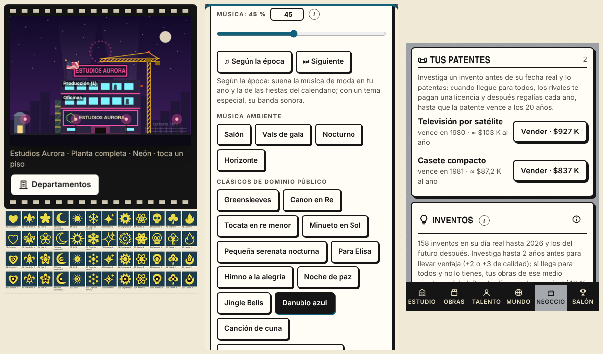

# UnoCero

## INDUSTRY ART · versión 1.1

Simulador de estudio de cine, series, videojuegos, teatro, música y libros, de 1700 a 2300.

### Jugar

Abre `industry-art/index.html` en cualquier navegador moderno, en el celular o en el computador. No necesita instalación ni conexión: todo el juego está en ese archivo.

- **Partida rápida**: un toque y el dado elige la época, el país y tu estudio.
- **Nueva partida**: eliges época, lugar, compañía, avatar, dinero y dificultad.
- Idiomas: español, inglés, francés y portugués.
- Las partidas se guardan en el navegador (5 ranuras y autoguardado) y se pueden exportar como `.iasave`.

### Diseño

- **Revista** (predeterminado): cada sección del juego es una sección de revista con su propio color de papel.
- **Época**: el diseño cambia con los años, igual que tu edificio: gaceta, art déco, pop, Memphis, digital y ciencia ficción.
- También: Minimalista, Oscuro, Claro, Alto contraste, Medianoche, Cine clásico, Bosque y Papel.
- **Temas especiales**: Espacial, Navidad, Halloween, Hollywood clásico, Bollywood, Anime, Cómic, Píxel, Plano 2D, Noir y Synthwave. Cambian los colores y decoran las ilustraciones; Píxel dibuja las ilustraciones en píxeles y Hollywood clásico y Noir las pasan a blanco y negro.
- **Corrientes estéticas**: Art Nouveau, Bauhaus, Constructivismo, Pop Art, Brutalismo, Vaporwave, Cyberpunk, Steampunk, Y2K, Solarpunk, Barroco y Suizo.
- **Historia**: las estéticas se alternan solas según el año, las fiestas del calendario y la época en que cada estilo estuvo de moda (o volvió a estarlo).
- **Decoración de temporada**: en cualquier tema, el edificio celebra Halloween, Navidad y Año Nuevo según el calendario del juego.
- **Símbolos**: cada estética tiene su ornamento (✦ ❦ ⚜ ☾ ❄ ⚙ ☀ …) en las portadillas y en los selectores, y el creador de logos suma 12 formas nuevas: corazón, flor de lis, flor, luna, sol, copo de nieve, destello, engranaje, átomo, calavera, trébol y llama.
- **Modo claro y oscuro** en todos los temas, y estilo de ilustración 2D o píxel.

### Música

- **Según la época**: suena la música de moda en el año de tu partida, la de las fiestas (villancicos en diciembre, órgano y pizzicato en Halloween) y, con un tema especial, su banda sonora (chiptune con Píxel, synthwave con Synthwave, el Danubio azul con Espacial…). Cada pieza cambia sola cada minuto o dos, y el botón Siguiente salta a otra.
- **Clásicos de dominio público**, con arreglos propios: Greensleeves, Pachelbel, la Tocata en re menor, el Minueto en Sol, Mozart, Beethoven, Noche de paz, Jingle Bells, Strauss, Brahms, Grieg, Chopin, Satie, Joplin y When the Saints. Solo suenan desde el año en que se publicaron.
- **Electrónica original**: chiptune, synthwave, rock and roll, house, apertura de anime, lo-fi, darksynth, raga digital y ambiente espacial.
- Cada pieza trae un dato curioso en Ajustes.

### Negocio, construcciones y tecnología

- **Obras**: cada construcción levanta una obra con grúa y andamios en tu edificio. Puede retrasarse por lluvia o huelga, encarecerse o adelantarse; al terminar la inauguras y ganas prensa y fans.
- **Patentes**: si investigas un invento antes de su fecha real, lo patentas. Los rivales te pagan licencia cuando llega para todos y regalías cada año hasta que la patente vence a los 20 años. Puedes venderla.
- **Valor de la compañía**: cuánto pagaría un comprador por tu estudio, con su historial y tu puesto frente a los rivales.
- **Bolsa y ofertas de compra**: vende parte del estudio a inversionistas con dividendos y recompra, o recibe ofertas de grandes conglomerados.
- **Remodelaciones** de las construcciones viejas cada 40 años, con su propia obra.
- **Compañías aliadas**: grupos de teatro, ópera, ballet, títeres, circo y más piden firmar contigo; hacen temporadas, giras y obras nuevas, y te dan parte de la taquilla.
- **Reediciones** de tus libros: bolsillo, audiolibro y traducciones.
- **Encargos**: los proyectos que te proponen se pueden encomendar a una filial o a un rival para que lo hagan todo, o para editarlos tú.
- **Streaming y TV**: los lotes del catálogo suman títulos reales y la compra automática licencia contenido cada mes con un presupuesto.

### Modos de juego

- **Seis siglos**: campaña de nueve capítulos de 1737 a 2150, cada uno con su reto.
- **Reto semanal**: la misma semilla para todos durante la semana y récords en tu dispositivo.
- **Modo LAN**: juega con amigos en la misma red Wi-Fi, sin servidores. Salas con código de 6 dígitos, mensajes cifrados, marcador, reacciones, duelos con la misma semilla y botón para bloquear a otro jugador. Los estudios de tus amigos pueden entrar a tu mundo como rivales, también por archivo.

### Android

El proyecto de la app está en `android/` y empaqueta el mismo `industry-art/index.html`.

1. Copia `android/keystore.properties.ejemplo` como `android/keystore.properties` y completa la ruta y la contraseña de tu llave de subida.
2. Indica el SDK de Android en `android/local.properties` (`sdk.dir=/ruta/al/sdk`).
3. Desde `android/`, ejecuta `gradle assembleRelease bundleRelease`. El APK queda en `app/build/outputs/apk/release/` y el AAB en `app/build/outputs/bundle/release/`.

Los paquetes de la versión 1.1 están en `entregables/`.

### Lanzamiento

- `docs/plan-de-lanzamiento.md`: los pasos para publicar en Google Play.
- `docs/politicas-google-play.md`: la revisión de políticas y las respuestas de los formularios.
- `docs/ficha-tienda.md`: la ficha de la tienda en cuatro idiomas.
- `docs/privacidad.html`: la política de privacidad pública, para GitHub Pages.
- `android/play/`: ícono, gráfico destacado y capturas de 1080 × 1920 en español e inglés.
- `docs/sugerencias-y-lanzamiento.md`: ideas hechas y pendientes.

### Capturas

### Créditos

Creado por OneZero.
Tipografías: TeX Gyre Heros Condensed (GUST e-foundry, GUST Font License) e Inter (The Inter Project Authors, SIL Open Font License 1.1).
Música: obras clásicas y tradicionales de dominio público, arregladas y sintetizadas dentro del juego; las piezas electrónicas son originales de OneZero. El juego no incluye grabaciones de terceros.
